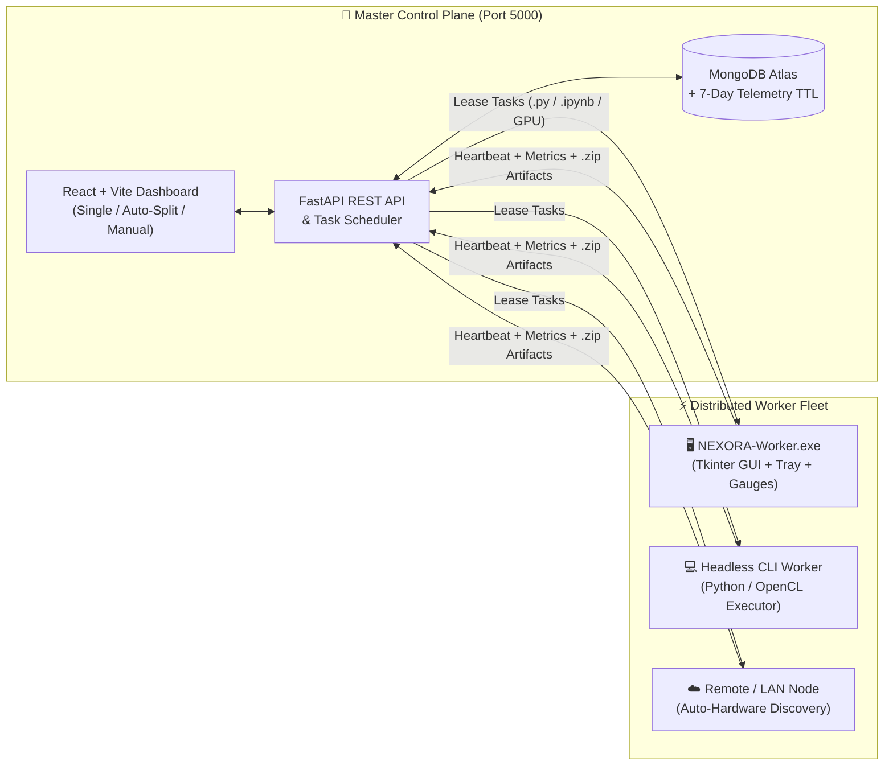

<div align="center">


# NEXORA

### **Distributed GPU & CPU Computing Platform**

*Orchestrate and distribute parallel compute workloads across Windows LAN networks and cloud clusters with zero friction.*

[](https://www.python.org/)
[](https://fastapi.tiangolo.com/)
[](https://react.dev/)
[](https://www.mongodb.com/atlas)
[](Dockerfile)
[](dist/NEXORA-Worker.exe)

[**Live Console**](https://nexora-ovke.onrender.com/) •
[**Architecture**](#-architecture-overview) •
[**Dispatch Modes**](#-graphical-dispatch-modes) •
[**Quick Start**](#-quick-start) •
[**Cloud Deploy**](#-cloud-deployment) •
[**Testing**](#-running-tests) •
[**Project Structure**](#-repository-structure)

</div>

---

## 📖 Overview

**NEXORA** turns idle Windows laptops, desktops, and cloud machines into a unified, browser-controlled compute cluster. A single **Master Control Plane** serves both the REST API and the React dashboard, while lightweight **Worker Agents** (`NEXORA-Worker.exe` or headless CLI) auto-discover local GPU/CPU hardware, stream live telemetry, lease tasks, and return `.zip` result bundles.

---

## 🧭 Architecture Overview



---

## ✨ Key Highlights

| Capability | Description |
| :--- | :--- |
| **100% Graphical Dispatch** | Button-driven job orchestration — no raw JSON editing required in the UI. |
| **1-Click Desktop Worker** | Standalone [`NEXORA-Worker.exe`](dist/NEXORA-Worker.exe) with **zero Python, Git, or CLI setup** on worker machines, live CPU/RAM/GPU gauges, auto-reconnect, and system tray status indicator. |
| **Unified Master Server** | Single FastAPI process serves both the API and built React SPA on port `5000`. |
| **Supported Workloads** | Execute Jupyter notebooks (`.ipynb`), custom Python scripts (`.py`), and OpenCL / GPU-accelerated matrix & math operations with automatic `.zip` artifact bundling. |
| **MongoDB Atlas Persistence** | Cloud-native persistence with automated 7-day TTL indexes for telemetry logs and dynamic per-test database isolation. |
| **Production Cloud Ready** | Multi-stage [`Dockerfile`](Dockerfile) (Node 20 builder + Python 3.12 runner) and [`render.yaml`](render.yaml) blueprint. |

---

## 🎛️ Graphical Dispatch Modes

Choose how workloads are distributed across your cluster directly from the **Workloads & Jobs** view:

| Mode | Best For | Behavior |
| :--- | :--- | :--- |
| ⚡ **Single Run** | Quick notebook or script execution | Dispatches a single task to the best available online worker node. |
| 🤖 **Smart Auto-Split** | Parallel batch & ML workloads | Auto-detects online GPU/CPU nodes and dynamically recommends optimal slice counts. |
| 🎛️ **Manual Pick** | Targeted hardware execution | Lets you pin tasks directly to specific approved worker nodes via checkboxes. |

---

## 🚀 Quick Start

### 1. Configure Environment

Create a `.env` file from [`.env.example`](.env.example):

```env
MONGODB_URI=mongodb+srv://<username>:<password>@<cluster>.mongodb.net/?retryWrites=true&w=majority
NEXORA_DB_NAME=nexora
SECRET_KEY=replace-with-a-secure-random-secret-key
PORT=5000
```

### 2. Start the Master Server (Dashboard + API)

Double-click [`start_backend.bat`](start_backend.bat) or run:

```powershell
python -m uvicorn backend.app.main:app --host 0.0.0.0 --port 5000 --reload
```

Open **[http://localhost:5000](http://localhost:5000)** in your browser.

### 3. Connect a Worker Node

<table>
<tr>
<td width="50%" valign="top">

#### Option A: 1-Click Desktop GUI *(Recommended)*
1. Download or run [`dist/NEXORA-Worker.exe`](dist/NEXORA-Worker.exe) (or [`scripts/start-worker-gui.bat`](scripts/start-worker-gui.bat)).
2. Verify auto-detected CPU, RAM, and GPU specs.
3. Enter your Master URL (`http://localhost:5000`, LAN IP `http://192.168.x.x:5000`, or your cloud URL).
4. Click **`Connect GPU / CPU to Cluster`**.
5. Approve the node in the Master Dashboard under **Overview / Nodes**.

</td>
<td width="50%" valign="top">

#### Option B: Headless Terminal Worker
For servers or CLI-only environments:

```powershell
.\scripts\start-worker.bat
```

Or via PowerShell:

```powershell
.\scripts\start-worker.ps1
```

</td>
</tr>
</table>

---

## ☁️ Cloud Deployment

<details>
<summary><b>Deploy with Render (1-Click Blueprint) or Docker</b></summary>

### Render (`render.yaml`)
1. Push this repository to GitHub.
2. Create a new **Blueprint** or **Web Service** on Render using [`render.yaml`](render.yaml).
3. Set `MONGODB_URI` in the Render dashboard (`SECRET_KEY` is auto-generated).
4. Render builds the multi-stage Docker image and serves both the dashboard and downloadable `NEXORA-Worker.exe`.

### Docker (Self-Hosted)
```bash
docker build -t nexora-master .
docker run -d -p 5000:5000 --env-file .env --name nexora nexora-master
```

</details>

---

## 🧪 Running Tests

Run the full backend and worker test suite with [`run_tests.bat`](run_tests.bat) or via CLI:

```powershell
python -m pytest backend/tests worker_agent/tests -v
```

<details>
<summary><b>What the test suite verifies</b></summary>

- **Authentication & Sessions:** Registration, login, and bearer token validation.
- **Cluster & Pairing:** Cluster creation, worker registration, approval, and heartbeats.
- **Scheduling & Leasing:** Automatic and manual task distribution, lease acquisition, and completion.
- **Execution & Telemetry:** Deterministic task execution, hardware discovery, and monitoring metrics.
- **Network Diagnostics:** Preflight LAN/host reachability checks.

</details>

---

## 📚 Additional Documentation

- [Architecture Specification](docs/architecture.md)
- [Data Model & API Reference](docs/data-model-and-api.md)
- [Phase 1 Audit](docs/phase-1-audit.md)

---

## 📁 Repository Structure

<details>
<summary><b>Click to expand full directory layout</b></summary>

```text
NEXORA/
├── backend/                  # FastAPI Master Application
│   ├── app/
│   │   ├── main.py           # Core REST API + SPA static server
│   │   ├── mongo_db.py       # MongoDB Atlas connection & TTL indexes
│   │   ├── network.py        # Preflight network diagnostics
│   │   └── workloads.py      # Manifest & execution validators
│   ├── requirements.txt      # Python backend dependencies
│   └── tests/                # Master API & network test suite
├── frontend/                 # React + TypeScript + Vite Dashboard
│   ├── public/               # Brand logos & favicons
│   ├── src/                  # Dashboard UI components & views
│   └── dist/                 # Built production frontend assets
├── nexora_worker_gui/        # Standalone Worker Desktop GUI (Tkinter)
│   ├── assets/               # App & system tray icons
│   └── worker_app.py         # 1-Click Worker application source
├── worker_agent/             # Headless Worker Engine & OpenCL Executor
│   ├── agent/                # Hardware discovery, metrics & safe execution
│   └── tests/                # Executor, hardware & monitoring tests
├── dist/                     # Compiled executables (NEXORA-Worker.exe)
├── docs/                     # Architecture & API documentation
├── scripts/                  # Automation scripts (.bat & .ps1)
├── Dockerfile                # Multi-stage production container
├── render.yaml               # Render deployment blueprint
├── start_backend.bat         # 1-Click Master launcher
└── run_tests.bat             # 1-Click test runner
```

</details>
